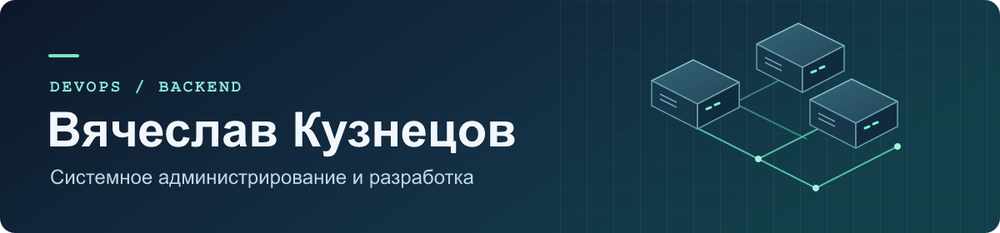

Разворачиваю серверы и базы данных, запускаю сервисы в контейнерах и настраиваю мониторинг. Основные языки для серверной разработки — **Python и Go**. Когда проекту нужен интерфейс, работаю с React, Next.js и Vue.

### С чем я работаю

| Направление | Задачи и инструменты |
| --- | --- |
| Инфраструктура | Администрирование Linux, развёртывание серверов и баз данных |
| Контейнеры | Docker, Docker Compose, Kubernetes |
| Эксплуатация | Мониторинг сервисов, работа с логами и диагностика сбоев |
| Backend | Python, Go, HTTP API, PostgreSQL, SQLite |

### Избранные проекты

| Проект | Что внутри |
| --- | --- |
| [Event Sphere](https://github.com/serlas/event-spherre) | Командная платформа для мероприятий. Карта и каталог на Nuxt и Vue, регистрация и профили на Go и PostgreSQL. |
| [SysAudit](https://github.com/serlas/gitverse-sysaudit) | Утилита на Python для аудита прав файлов, наблюдения за каталогами и хранения истории изменений в Git. |
| [ConfigService](https://github.com/serlas/gitverse-configservice) | HTTP-сервис конфигурации на Python. Каждая настройка хранится в файле, её изменения можно проследить в Git. |
| [Помощник для малого бизнеса](https://github.com/serlas/alfa-business-assistant) | Командный проект хакатона Альфа-Банка. Чат учитывает профиль компании и загруженные документы. Стек — Go, Next.js и SQLite. |
